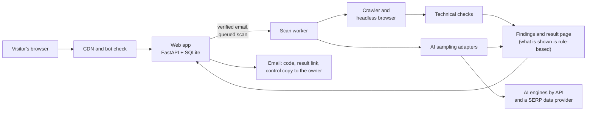

# SearchedBy engineering notes

How I build and run [SearchedBy](https://searchedby.com/) (formerly GEO Scan), a small AI product, with Claude Code writing most of the code and me owning the rules, the reviews and the decision to ship.

This repository holds the parts of that work that can be public: the operating model, sanitized decision records, the test, deploy and evaluation process, the cost model, a summary of the security review, and a few generic tools I use to ship changes. The product code, the scoring rules, the prompts and the questions the scan asks are private and are not here.

Case study on the operating model: [pablodpavon.com/proyectos/ai-systems-operating-model.html](https://pablodpavon.com/proyectos/ai-systems-operating-model.html)

## What SearchedBy does

A business enters its website. A few minutes later it gets a result page with two parts:

- what its site is missing for AI crawlers and AI search (21 automated checks in the free scan);
- what AI assistants actually answer when a customer asks about its type of business, in its market: whether the business is named, cited or missing, and who shows up instead.

It is an open beta. Every result is reviewed by me before it counts.

## Architecture, at a high level



One server in the EU, behind Cloudflare. Anti-abuse limits, email verification and a bot check sit in front of anything that spends money on paid APIs. Per-scan and daily cost caps are enforced in code.

## Stack

| Layer | Tools |
|---|---|
| Web app | Python, FastAPI, SQLite, Jinja templates |
| Scan | httpx, Playwright with Chromium, adapters for ChatGPT, Perplexity, Claude and Google AI Overviews / AI Mode (engines configurable per market) |
| Quality | pytest, two Python versions (3.13 and 3.12), blind evaluation sets, native-speaker review |
| Ship | Shell deploy scripts, backup before every deploy, md5 parity check between my machine and the server |
| Build | Claude Code (local sessions and cloud sessions on separate branches) |

## Numbers

All figures come from my own project records. Dates matter because the numbers move every day.

| What | Figure | As of |
|---|---|---|
| Automated tests | 2,684 pipeline + 1,184 web app (about 3,800) | 1 Nov 2026 |
| Python versions every suite must pass on | 2 | since 28 Oct 2026 |
| Files where server md5 = local md5 after a deploy | 197 of 197 | 30 Oct 2026 |
| Numbered decisions in the project log | 155 | 1 Nov 2026 |
| Deploy checklists and deploy records written | over 70 | 1 Nov 2026 |
| Findings in the independent security review | 14 (2 high, 6 medium, 6 low) | 30 Oct 2026 |
| Security tests run on the server after the fix deploy | 35 passed | 30 Oct 2026 |
| Real AI cost of one scan with 15 engine runs | US$ 0.2333 | 1 Nov 2026 |
| Interface languages | 4 (English, Spanish, German, Hebrew) | 1 Nov 2026 |

## The operating model

```mermaid
flowchart LR
    D["Decision<br/>numbered, dated, sourced"] --> B["Brief<br/>scope, cost, deliverable"]
    B --> T["Tests first<br/>red on the unchanged copy"]
    T --> C["Change in a working copy<br/>production untouched"]
    C --> G{"Gates"}
    G -->|"both suites green<br/>blind set, native review"| K["Deploy checklist<br/>list computed against production"]
    G -->|"any gate fails"| C
    K --> O["Owner OK"]
    O --> S["Backup, deploy,<br/>md5 parity, post-checks"]
    S --> L["Diary line with the time<br/>and the decision log updated"]
```



Each step has its own page:

- [Decision records](docs/adr/): eight sanitized examples in ADR format
- [Testing strategy](docs/testing.md)
- [Deploy and verification](docs/deploy.md)
- [Evaluation with blind sets](docs/evaluation.md)
- [Languages and native review](docs/multilingual.md)
- [Cost model](docs/cost-model.md)
- [Security review](docs/security-review.md)
- [Working with parallel agents](docs/agents.md)

## Tools in this repository

Small, standard-library-only Python tools, written from scratch for this repo. They contain nothing from the product.

| Tool | What it answers |
|---|---|
| `python -m shiptools.parity LEFT RIGHT` | Are these two copies byte-identical, file by file? Works with two folders, or a folder and a manifest copied from a server. |
| `python -m shiptools.deploylist BASE CANDIDATE` | Exactly which files does this change touch, measured against what is in production? Prints a table for the checklist and can write a TSV. |
| `python -m shiptools.anchored_edit PLAN.json ROOT` | Apply a reviewed edit plan to a fresh copy: every anchor must appear exactly once, nothing is written if one check fails, and a second run is refused. |

```sh
python -m pip install -e ".[test]"
python -m pytest
```

Example after a deploy (the server writes its manifest with `md5sum`, you copy it back):

```sh
python -m shiptools.parity ./app server_md5.txt --include app tests
# PARITY OK: 197/197 identical
```

The tests run on Python 3.12 and 3.13 in CI, the same rule the product follows.

## What is not here, on purpose

- Product code, scoring rules, weights, prompts and the questions sent to AI engines.
- Server details: addresses, paths, user names, configuration.
- Any client data or client name. Examples use invented sites.

## License

MIT for the code and the documents in this repository. See [LICENSE](LICENSE).

Pablo Pavon · [pablodpavon.com](https://pablodpavon.com) · contact@pablodpavon.com
